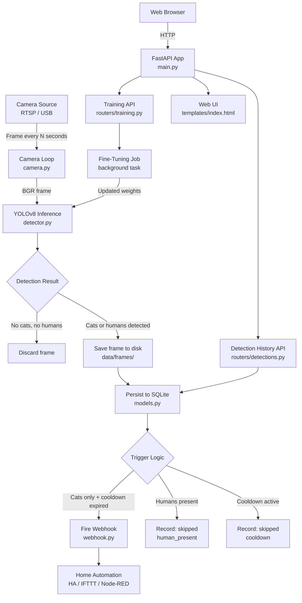

# Product Requirements Document: Cat Detector

| Field            | Value                          |
|------------------|--------------------------------|
| Document Version | 1.0                            |
| Date             | 2026-04-06                     |
| Author           | Radu Simionescu                |
| Status           | Draft                          |
| Stakeholders     | Pet owner (primary user), Developer/Operator |

---

## Table of Contents

1. [Problem Statement](#1-problem-statement)
2. [User Personas Affected](#2-user-personas-affected)
3. [Success Metrics](#3-success-metrics)
4. [Proposed Solution Overview](#4-proposed-solution-overview)
5. [Out of Scope Items](#5-out-of-scope-items)
6. [Dependencies and Risks](#6-dependencies-and-risks)
7. [Release Strategy](#7-release-strategy)

---

## 1. Problem Statement

Homeowners with outdoor garden furniture frequently find that neighbourhood cats visit and occupy their garden sofas, leaving behind fur, scratches, and other damage. There is currently no affordable, privacy-respecting way to get real-time alerts when cats are present in the garden -- especially when the homeowner is away from the window or not at home.

Existing solutions fall short in specific ways:

- **Generic motion-detection cameras** trigger on all movement (wind, birds, shadows), producing excessive false alarms that train users to ignore notifications entirely.
- **Commercial pet deterrent devices** (ultrasonic emitters, sprinklers) activate indiscriminately and cannot distinguish between a cat lounging on furniture versus passing through harmlessly. They also provide no historical record.
- **Manual checking** requires the homeowner to repeatedly look out the window or watch a live camera feed, which is impractical and time-consuming.

Cat Detector solves this by applying computer vision specifically trained to recognise cats (YOLO COCO class 15) while filtering out human presence (class 0). When cats are detected on the garden sofa and no humans are present, the system fires a webhook notification that can integrate with any home automation platform. It also provides a web-based history of all detections so the homeowner can review patterns, label false positives, and iteratively improve the model's accuracy through fine-tuning.

**Core value proposition:** Precise, automated "cats on the sofa" alerts with a feedback loop that gets smarter over time, running entirely on local hardware with no cloud dependency.

---

## 2. User Personas Affected

### Persona 1: Dana -- The Garden-Proud Pet Owner (Primary)

| Attribute     | Detail |
|---------------|--------|
| Role          | Homeowner with an outdoor garden sofa |
| Technical Skill | Low to moderate -- comfortable with smartphones and basic smart home devices |
| Goal          | Get notified promptly when neighbourhood cats are on the garden sofa so she can shoo them away or trigger a deterrent |
| Pain Points   | Misses cat visits when indoors or away; generic motion alerts are too noisy; no record of how often cats visit or at what times |
| Interaction   | Receives webhook-driven push notifications (via Home Assistant, IFTTT, or similar); occasionally opens the web UI on a tablet to browse detection history |
| Success Looks Like | Fewer ruined sofa cushions; confidence that she will be alerted within seconds of a cat arriving; ability to see visit frequency trends |

### Persona 2: Marco -- The Developer/Operator (Secondary)

| Attribute     | Detail |
|---------------|--------|
| Role          | The person who sets up and maintains the Cat Detector service |
| Technical Skill | High -- comfortable with Python, Docker, Linux services, and network cameras |
| Goal          | Deploy a reliable, low-maintenance detection service on a Raspberry Pi or home server with minimal ongoing intervention |
| Pain Points   | Wants clear configuration via environment variables, not hardcoded values; needs the system to recover gracefully from camera disconnections and network hiccups; wants easy model upgrades |
| Interaction   | Edits `.env` files, monitors logs, reviews the web UI to label detections and trigger fine-tuning when accuracy drifts |
| Success Looks Like | System runs unattended for weeks; exponential backoff handles camera flakiness; fine-tuning workflow is straightforward |

### Persona 3: Sofia -- The Home Automation Enthusiast (Tertiary)

| Attribute     | Detail |
|---------------|--------|
| Role          | Smart home hobbyist who integrates many devices and services |
| Technical Skill | Moderate to high -- uses Home Assistant, Node-RED, or similar platforms |
| Goal          | Integrate cat detection events into broader automation flows (e.g., activate sprinkler, flash garden lights, send Telegram message) |
| Pain Points   | Needs a clean, documented webhook payload she can parse in automation rules; wants cooldown control so automations are not triggered in rapid succession |
| Interaction   | Configures the webhook URL and secret once; builds downstream automations; never uses the web UI directly |
| Success Looks Like | Reliable JSON payloads arrive at her automation endpoint; cooldown prevents duplicate triggers; webhook failures do not crash the detector service |

---

## 3. Success Metrics

### 3.1 Technical Metrics

| Metric | Target | Measurement Method |
|--------|--------|--------------------|
| Detection accuracy (cat presence) | Greater than 90% true positive rate after initial deployment | Calculated from user labels in the web UI (true_positive / (true_positive + false_negative)) |
| False positive rate | Less than 10% of webhook triggers are false positives | Calculated from user labels (false_positive / total webhook triggers) |
| Detection latency | Cat detected within 2x the configured sampling interval (default: under 10 seconds) | Timestamp delta between frame capture and webhook dispatch |
| Service uptime | Greater than 99% during monitored hours | Calculated from camera loop heartbeat logs; excludes planned maintenance |
| Camera reconnection time | Recovers from a dropped connection within 60 seconds | Measured by exponential backoff logs converging within `CAMERA_RECONNECT_MAX_DELAY` |
| Webhook delivery success rate | Greater than 95% of triggered webhooks receive a 2xx response | Logged success/failure ratio in `webhook.py` |

### 3.2 User-Facing Metrics

| Metric | Target | Measurement Method |
|--------|--------|--------------------|
| Time from cat arrival to user notification | Under 15 seconds (sampling interval + webhook + downstream delivery) | End-to-end measurement including automation platform latency |
| Labeling engagement | At least 20 detections labeled within first 2 weeks of deployment | Count of `labeled_at IS NOT NULL` records in the database |
| Fine-tuning improvement | Measurable accuracy improvement (at least 5 percentage points) after first fine-tuning cycle | Before/after comparison of false positive rate over a 1-week window |
| Web UI usability | User can find and label a detection in under 30 seconds | Informal observation during initial deployment |

### 3.3 Business/Outcome Metrics

| Metric | Target | Measurement Method |
|--------|--------|--------------------|
| Reduction in unnoticed cat visits | At least 80% of cat visits during monitored hours produce a user alert | Cross-reference webhook logs with manual observation during a calibration period |
| User satisfaction | The primary user (Dana persona) continues using the system after 30 days | Qualitative check-in; system remains powered on and configured |

---

## 4. Proposed Solution Overview

### 4.1 High-Level Architecture

Cat Detector is a single-process Python service built on FastAPI that runs locally on a home server or Raspberry Pi. It combines a background camera sampling loop with a web API and UI, all within one deployable unit.

The system is organised into four functional layers:

1. **Capture Layer** -- Periodically grabs frames from an RTSP or USB camera source using OpenCV.
2. **Detection Layer** -- Runs YOLOv8 inference on each captured frame to identify cats and humans.
3. **Action Layer** -- Evaluates detection results against business rules (cats present, no humans) and fires a webhook with cooldown enforcement.
4. **Review Layer** -- Persists all detections to SQLite, serves a web UI for browsing history and labeling, and exposes a fine-tuning trigger endpoint.

### 4.2 System Flow Diagram



### 4.3 Feature Set Mapped to User Stories

#### Feature 1: Live Camera Monitoring (US-1, P1)

**Status:** Implemented.

The background camera loop (`camera.py`) samples frames from the configured `CAMERA_URL` at a fixed interval (default 5 seconds). It supports both RTSP network cameras and local USB devices (specified as an integer device index). When the camera connection drops, the loop applies exponential backoff up to a configurable maximum delay (`CAMERA_RECONNECT_MAX_DELAY`, default 60 seconds). The loop runs as an asyncio background task within the FastAPI lifespan and responds to SIGTERM for clean shutdown.

**Key configuration:**
- `CAMERA_URL` -- RTSP URL or device index
- `DETECTION_INTERVAL_SECONDS` -- Sampling frequency
- `CAMERA_RECONNECT_MAX_DELAY` -- Maximum backoff ceiling

#### Feature 2: Cat Detection with Human Guard (US-2, P1)

The detection engine (`detector.py`) loads a YOLOv8 model (size configurable from `yolov8n` to `yolov8x`) and runs inference on each captured frame. It extracts two COCO classes: cat (class 15) and person (class 0). The trigger logic is explicit:

- Cats detected AND no humans present --> trigger webhook
- Cats detected AND humans present --> suppress (reason: `human_present`)
- No cats detected --> no action

Detection results (cat count, human count, maximum cat confidence, annotated frame) are returned as a structured `DetectionResult` dataclass. The confidence threshold is configurable via `DETECTION_CONFIDENCE`.

All detections where at least one cat or human is present are persisted to the database with the annotated frame saved to disk.

#### Feature 3: Webhook Alert on Cat Detection (US-3, P2)

When the trigger logic approves a detection, the webhook module (`webhook.py`) sends an HTTP POST to the configured `WEBHOOK_URL`. The JSON payload includes:

```json
{
  "event": "cat_detected",
  "detection_id": 42,
  "cat_count": 2,
  "max_confidence": 0.8734
}
```

A cooldown mechanism (default 300 seconds / 5 minutes) prevents alert spam by suppressing subsequent webhooks within the cooldown window. An optional `WEBHOOK_SECRET` is sent as the `X-Webhook-Secret` header for downstream authentication. Webhook failures are logged but do not crash the service or block the camera loop.

#### Feature 4: Detection History Web UI (US-4, P2)

The web interface (`templates/index.html`) presents a paginated, newest-first grid of detection cards. Each card displays:

- The annotated frame image (with YOLO bounding boxes)
- Timestamp
- Cat count and confidence percentage
- Human count (if any)
- Webhook status (sent or skipped with reason)
- Labeling buttons

The API endpoint (`GET /api/detections`) supports `skip` and `limit` query parameters for pagination. The UI auto-refreshes every 30 seconds.

**Open items (from US-4):**
- Date range filtering UI design is not yet specified -- needs UX decision on whether to use date picker inputs or predefined ranges (today, last 7 days, last 30 days).
- Performance metric display (e.g., detection count, average confidence) is requested but scope is undefined.

#### Feature 5: Detection Labeling for Fine-Tuning (US-5, P3)

Each detection card in the web UI includes "True positive" and "False positive" buttons. Clicking a button sends a `POST /api/detections/{id}/label` request that persists the label and timestamp to the database. The status bar at the top of the page shows running counts of true positives, false positives, and unlabeled detections.

Labels use an enum: `unlabeled`, `true_positive`, `false_positive`.

**Open items (from US-5):**
- Whether relabeling (changing a label after it is set) should be supported or require an explicit "undo" step.
- Whether a "labeling queue" mode (showing only unlabeled detections in sequence) would improve labeling throughput.

#### Feature 6: Model Fine-Tuning Trigger (US-6, P4)

The training router (`routers/training.py`) exposes:

- `GET /api/training/status` -- Returns label counts and training job status (idle or in_progress).
- `POST /api/training/trigger` -- Starts a background fine-tuning job using labeled frames.

The fine-tuning implementation is currently a stub. The intended flow is: export labeled frames to a YOLO dataset layout, run `model.train()`, save new weights, and hot-reload the detection model.

**This story is flagged for splitting into three stories:**
1. Fine-tuning API endpoint and background job execution (M)
2. Model hot-reload after training completes (S)
3. UI controls for training status and trigger (S)

**Open items (from US-6):**
- Minimum label threshold before training is allowed (proposed: 20 labeled detections).
- Rollback mechanism if the fine-tuned model performs worse.
- Whether label balance (ratio of true positives to false positives) should be enforced or warned about.

#### Feature 7: Environment-Based Configuration (US-7, P1)

**Status:** Implemented.

All runtime parameters are configured via environment variables or a `.env` file using Pydantic Settings. The configuration module (`config.py`) defines typed fields with sensible defaults. No secrets are hardcoded. Missing required values (such as `CAMERA_URL` for a real deployment) produce clear startup errors.

### 4.4 Data Model

The core entity is `Detection`, stored in SQLite:

| Column                 | Type     | Description |
|------------------------|----------|-------------|
| `id`                   | Integer  | Primary key, auto-increment |
| `created_at`           | DateTime | Server-generated timestamp, indexed |
| `cat_count`            | Integer  | Number of cats detected in frame |
| `human_count`          | Integer  | Number of humans detected in frame |
| `max_cat_confidence`   | Float    | Highest confidence score among detected cats |
| `webhook_triggered`    | Boolean  | Whether the webhook was fired for this detection |
| `webhook_skipped_reason` | String | Reason webhook was suppressed (null, `no_cats`, `human_present`, `cooldown`) |
| `frame_path`           | String   | Relative path to the saved annotated frame on disk |
| `label`                | String   | Human-assigned label (`unlabeled`, `true_positive`, `false_positive`) |
| `labeled_at`           | DateTime | When the label was assigned |

### 4.5 API Surface

| Method | Endpoint                          | Purpose |
|--------|-----------------------------------|---------|
| GET    | `/`                               | Serve the web UI |
| GET    | `/api/detections`                 | List detections (paginated) |
| GET    | `/api/detections/{id}/frame`      | Serve a detection's frame image |
| POST   | `/api/detections/{id}/label`      | Label a detection as true/false positive |
| GET    | `/api/training/status`            | Get label counts and training status |
| POST   | `/api/training/trigger`           | Start a fine-tuning background job |

---

## 5. Out of Scope Items

The following capabilities are explicitly excluded from this product's scope. They may be considered for future iterations but are not part of the current roadmap.

| Item | Rationale |
|------|-----------|
| **Multi-camera support** | The system is designed for a single camera pointed at one location (the garden sofa). Supporting multiple cameras would require frame routing, per-camera configuration, and a more complex data model. |
| **Cloud deployment or cloud-based inference** | The product runs entirely on local hardware for privacy and latency reasons. There is no cloud API, no remote storage, and no telemetry. |
| **Mobile application** | The web UI is accessible from mobile browsers. A native app adds significant development and maintenance cost with marginal benefit for this use case. |
| **Real-time video streaming** | The system samples frames at intervals, not continuous streaming. Live video would increase CPU/memory/bandwidth requirements substantially and is not needed for the alert use case. |
| **Species-specific cat identification** | The system detects "cat" as a generic class. Identifying individual cats (e.g., "this is the tabby from next door") would require a re-identification model and a cat registry, which is beyond scope. |
| **Audio alerts or audio detection** | The system is vision-only. Audio-based detection (meowing, hissing) or audio output (alarms, ultrasonic deterrents) is not included. |
| **Automatic deterrent actuation** | The system sends webhook notifications; it does not directly control sprinklers, lights, or ultrasonic devices. Actuation is the responsibility of the downstream automation platform. |
| **User authentication or multi-tenancy** | The web UI is assumed to be accessed only on the local network. There is no login, user management, or access control. |
| **Historical analytics or dashboards** | Beyond the paginated detection list, there are no charts, trend graphs, or statistical summaries. The raw data is available in SQLite for external analysis. |
| **Model training on the device** | While fine-tuning is triggered via the API, resource-constrained devices (e.g., Raspberry Pi) may not have sufficient GPU/CPU for actual YOLO training. The fine-tuning stub is designed to be replaced with a training pipeline that may run on a separate machine. |

---

## 6. Dependencies and Risks

### 6.1 External Dependencies

| Dependency | Type | Impact if Unavailable |
|------------|------|-----------------------|
| **Camera hardware** (RTSP camera or USB webcam) | Hardware | System cannot capture frames. Exponential backoff handles temporary disconnections, but a permanently failed camera halts all detection. |
| **YOLOv8 model weights** (ultralytics) | Software/Network | Model weights are downloaded on first run. If the host has no internet access during initial setup, the model file must be pre-provisioned. After first download, weights are cached locally. |
| **Webhook endpoint** (Home Assistant, IFTTT, etc.) | External service | Webhook failures are handled gracefully (logged, not retried). If the endpoint is permanently down, the user receives no alerts, but detections continue to be recorded in the database. |
| **Python 3.11+** and system dependencies (OpenCV, SQLite) | Runtime | Standard deployment requirement. OpenCV may need system-level libraries (`libgl1`, `libglib2.0`) on headless Linux servers. |

### 6.2 Risks and Mitigations

| Risk | Likelihood | Impact | Mitigation |
|------|------------|--------|------------|
| **High false positive rate in initial deployment** | Medium | Users lose trust in alerts and stop responding | Configurable confidence threshold; labeling workflow feeds fine-tuning to improve over time; start with conservative threshold (0.5+) |
| **Camera placement produces poor detection results** | Medium | Cats are not detected due to angle, distance, lighting, or occlusion | Document recommended camera placement (eye-level, unobstructed view of sofa, adequate lighting); allow model size upgrade (`yolov8n` to `yolov8x`) for harder scenes |
| **SQLite database grows unbounded** | Medium | Disk space exhaustion on resource-constrained devices | Future: add a retention policy or manual purge endpoint. Current mitigation: SQLite is efficient and the frame-per-detection rate is low (one every 5 seconds, only when cats/humans are present) |
| **Frame storage fills disk** | Medium | Same as above, but for JPEG files on disk | Same mitigation: low write rate in practice. Future: configurable retention with automatic cleanup. |
| **Fine-tuned model performs worse than baseline** | Low | Detection accuracy degrades after training | Future: implement rollback mechanism (US-6 open item). Current: operator can manually restore baseline weights by resetting `DETECTION_MODEL` in `.env`. |
| **Camera loop crash or hang** | Low | No frames captured, no detections, no alerts | Broad exception handler in the camera loop prevents crashes. For hangs: deploy with a process supervisor (systemd) that can restart the service. |
| **Webhook secret exposed in `.env` file** | Low | Unauthorized parties could forge webhook calls to the automation platform | Document that `.env` should have restricted file permissions (600). The webhook secret is optional and its exposure does not compromise the detector itself. |
| **Night-time detection accuracy drops significantly** | Medium | Cats visiting after dark are missed | IR-capable camera recommended for outdoor deployment; document this as a hardware requirement. YOLO models handle IR/grayscale frames reasonably well. |

---

## 7. Release Strategy

### Phase 1: MVP (Priority 1 stories -- US-1, US-2, US-7)

**Goal:** A working detection loop that captures frames, identifies cats, and persists results.

**Scope:**
- Camera sampling loop with exponential backoff reconnection (US-1) -- DONE
- YOLOv8 detection with cat/human classification and trigger logic (US-2)
- Environment-based configuration via `.env` (US-7) -- DONE

**Exit criteria:**
- Service starts, connects to camera, runs inference, and persists detections to SQLite
- Logs show correct cat/human counts for test frames
- Configuration changes via `.env` take effect on restart

**Target:** This phase represents the current state of the codebase. Core detection pipeline is functional.

### Phase 2: Alerts and Visibility (Priority 2 stories -- US-3, US-4)

**Goal:** Users receive real-time alerts and can review detection history.

**Scope:**
- Webhook integration with cooldown and failure handling (US-3)
- Web UI with paginated detection history and frame viewing (US-4)

**Exit criteria:**
- Webhook fires within one detection cycle when cats are present and no humans are detected
- Cooldown correctly suppresses duplicate alerts
- Web UI loads, displays detection cards with images, and supports pagination
- Date range filtering is implemented (pending UX decision from US-4 open items)

**Target:** End-to-end system usable by the primary persona (Dana). She receives alerts and can browse history.

### Phase 3: Feedback Loop (Priority 3-4 stories -- US-5, US-6)

**Goal:** Users can improve detection accuracy over time through labeling and fine-tuning.

**Scope:**
- Detection labeling UI with true/false positive buttons (US-5)
- Fine-tuning trigger API, background job execution, and model hot-reload (US-6, split into 3 sub-stories)

**Exit criteria:**
- Labels persist correctly and counts display in the status bar
- Fine-tuning can be triggered with at least 20 labeled detections
- New model weights are loaded without service restart
- Open items resolved: relabeling behavior, minimum label threshold, rollback strategy

**Target:** System enters a continuous improvement cycle. The operator (Marco) periodically labels detections and triggers fine-tuning to reduce false positives.

### Future Considerations (Not Scheduled)

The following items are not on the current roadmap but are natural extensions if the product proves successful:

- **Retention policy** -- Automatic cleanup of old detections and frames beyond a configurable age
- **Date range filtering** -- Enhanced query capabilities for the detection history API and UI
- **Detection statistics** -- Summary dashboard with detection frequency, accuracy trends, and peak visit times
- **Notification channels** -- Direct integration with Telegram, email, or push notifications (bypassing the generic webhook)
- **Multi-zone detection** -- Define regions of interest within the frame to reduce false triggers from cats walking through the background
- **Model marketplace** -- Share and import fine-tuned models between Cat Detector instances

---

*End of document.*
